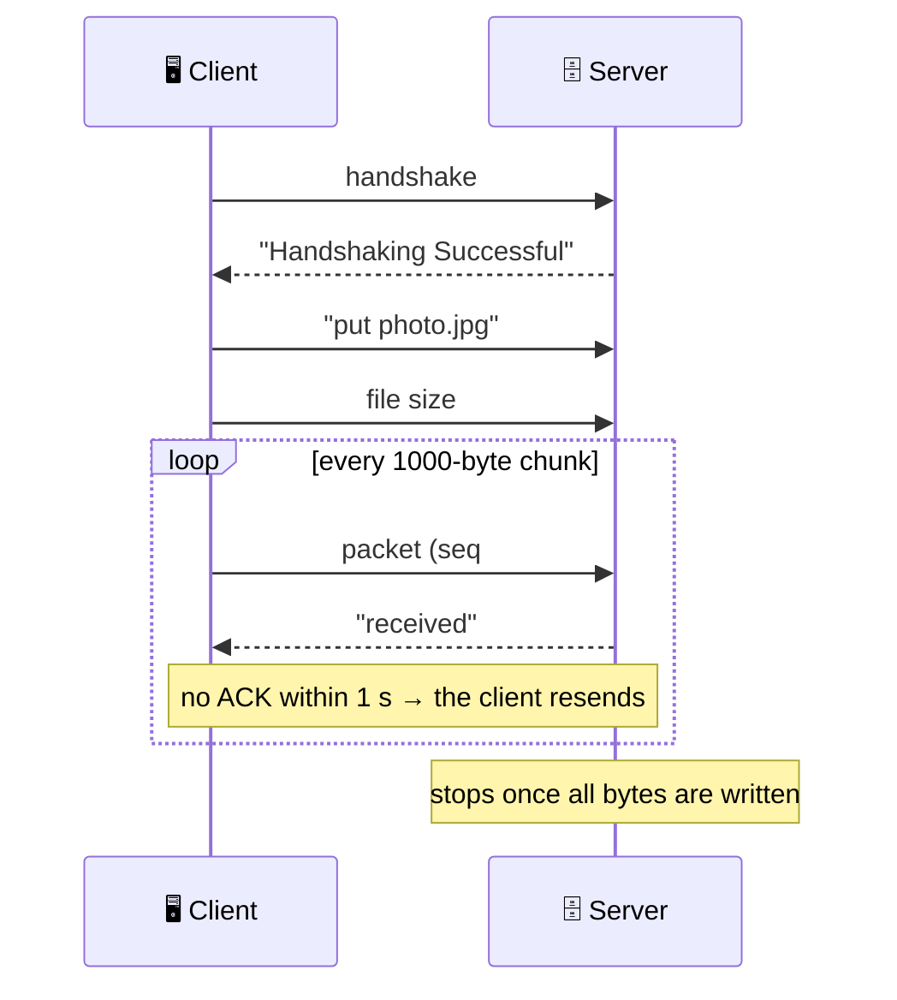

<div align="center">

# 📡 Xfer

### FTP-style file transfer built from scratch on UDP sockets


**UDP is unreliable by design. Xfer adds sequencing, checksums, acknowledgements and retransmission on top of it, so files still arrive intact.**

</div>

---

## ✨ Features

- 📤 **`put`**: upload a file to the server
- 📥 **`get`**: download a file from the server
- 🗑️ **`delete`**: remove a file on the server
- 📋 **`list`**: see every file the server holds
- 🔁 **Reliable delivery**: every packet is acknowledged, and unacknowledged packets are resent after a 1 s timeout
- 🔢 **Sequence numbers**: duplicate and re-sent packets are detected rather than written twice
- ✅ **Checksums**: each packet carries a checksum of its payload
- 🔐 **File encryption**: files are XOR-encrypted for the transfer and decrypted afterwards
- 🎞️ **Any file type**: text, images, even video (a demo clip is included)

## 🧩 How it works

Every packet is a fixed struct: a sequence number, a checksum and a **1000-byte payload**.



This is a **stop-and-wait** protocol: one packet in flight at a time, which keeps it simple and easy to reason about. If an ACK is lost, the server sees the same sequence number again, skips the write and just re-sends the ACK.

## 🚀 Quick start

You need `gcc` and `make`. Run the server and client in two terminals.

**1. Start the server**

```bash
cd Server
make
./server 18000        # 18000 = the port to listen on
```

**2. Start the client**

```bash
cd Client
make
./client 127.0.0.1 18000    # <server ip> <server port>
```

**3. Type commands at the menu**

```text
        *****UDP Based FTP*****

        1. get <filename>
        2. put <filename>
        3. delete <filename>
        4. list
        5. exit

        Enter Command: put foo1
```

Type the command **word** followed by the filename (for example `put foo1` or `get foo1`), not the menu number. Files are read from and saved to the directory each program was started in.

### 🎁 Sample files

| File | Use |
|---|---|
| `Client/foo1` | A tiny text file for a quick first transfer |
| `Client/ozil.mp4` | A ~13 MB video to see multi-packet transfer in action |

## ✅ Tested

The transfer was verified end to end (upload, then download into a clean folder, then SHA-256 comparison) at these file sizes:

| Size (bytes) | Why it matters | Result |
|---:|---|:-:|
| 1 | Smallest possible | ✅ |
| 700 | Single partial packet | ✅ |
| 1000 | Exactly one full packet | ✅ |
| 1001 | One full packet + 1 byte | ✅ |
| 2000 / 5000 | Exact multiples of the packet size | ✅ |
| 5001 / 12345 | Multi-packet with a remainder | ✅ |

## 📁 Project layout

```text
Xfer/
├── Client/
│   ├── client_ftp_udp.c     # main loop: handshake, menu, command dispatch
│   ├── command_handler.c/.h # put / get / delete / list, checksum, encryption
│   ├── makefile
│   ├── foo1                 # sample text file
│   └── ozil.mp4             # sample video
├── Server/
│   ├── server_ftp_udp.c     # handshake + command loop
│   ├── command_handler.c/.h # mirror image of the client's handlers
│   └── makefile
└── Functions_used.odt       # API notes for the socket and file functions used
```

## ⚠️ Good to know

This is a learning project, and I'd be upfront about its limits:

- 🔓 The XOR "encryption" and mod-100 checksum are **teaching tools, not security**. Don't use them to protect anything real.
- 👤 The server handles **one client at a time**.
- 🐢 Stop-and-wait is simple but slower than a sliding window over high-latency links.

## 🛠️ Concepts covered

`Berkeley sockets` · `UDP datagrams` · `Reliable-delivery design (ACK, timeout, retransmit)` · `Sequence numbers & duplicate detection` · `Checksums` · `Binary file I/O` · `Makefiles`

---

<div align="center">

Built by [Tanmay Chandavarkar](https://github.com/tanmayhc7)

</div>
